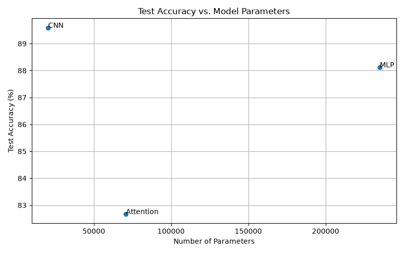
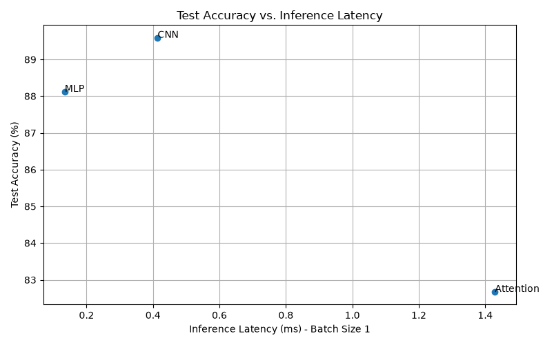

# Lab 03: Architectures and Their Costs

## 1. Introduction

The purpose of this laboratory is to compare three different neural network architectures: Multi-Layer Perceptron (MLP), Convolutional Neural Network (CNN), and Attention-based models.

The experiments use the Fashion-MNIST dataset, which contains images of clothing items belonging to 10 different classes.

Each model is trained and evaluated using the same dataset. Their performance is compared using:

- Number of trainable parameters.
- Computational cost (FLOPs).
- Inference latency.
- Training and test accuracy.

The main objective is to understand how different neural network architectures affect model performance and computational efficiency.

## 2. Dataset and Experimental Setup

### 2.1 Dataset

The Fashion-MNIST dataset was used for training and evaluating the three neural network models.

The dataset contains 70,000 grayscale images of clothing items, divided into 10 classes. Each image has a resolution of 28 × 28 pixels.

The dataset was divided into three parts:

| Dataset | Number of Images |
|---|---:|
| Training | 55,000 |
| Validation | 5,000 |
| Testing | 10,000 |

The images were converted into tensors and normalized using a mean of 0.2860 and a standard deviation of 0.3530.

### 2.2 Experimental Setup

All three models were implemented using PyTorch.

The following experimental settings were used:

| Setting | Value |
|---|---|
| Dataset | Fashion-MNIST |
| Framework | PyTorch |
| Batch size | 128 |
| Number of epochs | 5 |
| Optimizer | Adam |
| Learning rate | 0.001 |
| Loss function | Cross-Entropy Loss |
| Device | CPU |

## 3. Model Architectures

Three different neural network architectures were implemented and compared.

### 3.1 Multi-Layer Perceptron (MLP)

The MLP is a fully connected neural network. It takes each 28 × 28 image, flattens it into a vector of 784 values, and passes it through three linear layers.

The architecture is:

- Input: 784 features.
- First hidden layer: 256 neurons with ReLU activation.
- Second hidden layer: 128 neurons with ReLU activation.
- Output layer: 10 neurons for the 10 clothing classes.

### 3.2 Convolutional Neural Network (CNN)

The CNN uses convolutional layers to extract visual features from the images.

The architecture consists of:

- First convolutional layer: 16 filters with a 3 × 3 kernel.
- ReLU activation.
- Max pooling.
- Second convolutional layer: 32 filters with a 3 × 3 kernel.
- ReLU activation.
- Max pooling.
- Flattening layer.
- Final linear layer with 10 output neurons.

### 3.3 Attention Model

The Attention model uses a Transformer encoder to process image patches and learn relationships between them.

The image is divided into 16 patches, each with a size of 7 × 7 pixels.

The architecture consists of:

- Patch projection to 64 dimensions.
- Two Transformer encoder layers.
- Four attention heads.
- Feed-forward dimension of 128.
- Mean pooling to combine patch representations.
- Final linear layer with 10 output neurons.

## 4. Model Parameters and Computational Cost

### 4.1 Number of Parameters

The number of parameters represents the trainable weights and biases that a model learns during training.

The parameter counts obtained from PyTorch are shown below:

| Model | Number of Parameters |
|---|---:|
| MLP | 235,146 |
| CNN | 20,490 |
| Attention | 70,794 |

The MLP has the largest number of parameters because it uses fully connected layers. The CNN has the smallest number of parameters because convolutional filters are shared across the image. The Attention model has more parameters than the CNN but fewer than the MLP.

### 4.2 FLOPs Calculation

FLOPs (Floating Point Operations) estimate the computational work required for a forward pass.

The manual calculations used the following formulas:

**Linear layer:**

FLOPs = 2 × Input Features × Output Features

**Convolutional layer:**

FLOPs = 2 × Kernel Height × Kernel Width × Input Channels × Output Channels × Output Height × Output Width

The manually calculated FLOPs per image are:

| Model | Manual FLOPs |
|---|---:|
| MLP | 469,504 |
| CNN | 2,063,488 |
| Attention | 2,329,856 |

The Attention model has the highest estimated computational cost, followed by the CNN and MLP.

### 4.3 Comparison with THOP Profiling

THOP was also used to estimate computational operations.

| Model | Manual FLOPs | THOP FLOPs |
|---|---:|---:|
| MLP | 469,504 | 469,504 |
| CNN | 2,063,488 | 2,063,488 |
| Attention | 2,329,856 | 1,182,976 |

For the MLP and CNN, the manual calculations match the THOP results.

However, the Attention model has different results. THOP does not fully count all operations inside the Transformer attention layers by default. Therefore, its estimated FLOPs are lower than the manual calculation.

For this reason, the manual FLOPs calculation gives a more complete estimate for the Attention model in this experiment.

## 5. Inference Latency Results

Inference latency measures how long a model takes to make predictions.

The latency experiments were performed using two batch sizes: 1 and 128.

The measurements used 10 warm-up runs before recording the results. For batch size 1, 100 runs were measured. For batch size 128, 20 runs were measured. The median latency was used to reduce the effect of unusually slow or fast measurements.

### 5.1 Latency Results

| Model | Batch Size 1 (ms) | Batch Size 128 (ms) |
|---|---:|---:|
| MLP | 0.1343 | 1.4479 |
| CNN | 0.4140 | 20.9826 |
| Attention | 1.4291 | 11.0307 |

### 5.2 Latency Analysis

The MLP achieved the lowest inference latency for both batch sizes.

The CNN was slower than the MLP, especially with batch size 128. Its convolutional operations require more computation as the batch size increases.

The Attention model had the highest latency for batch size 1. However, it was faster than the CNN for batch size 128.

These results show that inference speed depends on both the model architecture and the batch size.

All measurements were performed on a CPU, so the results may differ on systems with a GPU.

## 6. Training and Test Accuracy

All three models were trained for 5 epochs using the Adam optimizer with a learning rate of 0.001.

After training, each model was evaluated using the Fashion-MNIST test dataset.

### 6.1 Training Results

The final training accuracy and test results are shown below:

| Model | Training Accuracy (%) | Test Loss | Test Accuracy (%) |
|---|---:|---:|---:|
| MLP | 89.93 | 0.3361 | 88.12 |
| CNN | 90.34 | 0.2890 | 89.59 |
| Attention | 84.59 | 0.4874 | 82.67 |

### 6.2 Accuracy Analysis

The CNN achieved the highest test accuracy of 89.59%, followed by the MLP with 88.12%.

The Attention model achieved a test accuracy of 82.67%, which was lower than the other two models.

The CNN performed best because convolutional layers can learn useful spatial features from images. The MLP also performed well, but it does not directly preserve the spatial relationships between image pixels.

The Attention model required more training to achieve comparable performance and had the lowest accuracy in this experiment.

## 7. Graphs and Model Comparison

### 7.1 Test Accuracy vs. Number of Parameters

The first graph compares test accuracy with the number of trainable parameters.

The CNN achieved the highest test accuracy while using the fewest parameters. The MLP had the largest number of parameters but did not achieve the highest accuracy.

This shows that having more parameters does not necessarily result in better model performance.

### 7.2 Test Accuracy vs. Inference Latency

The second graph compares test accuracy with inference latency for batch size 1.

The MLP achieved the lowest inference latency, while the CNN achieved the highest test accuracy.

The Attention model had higher latency than both models and achieved the lowest test accuracy.

### 7.3 Overall Comparison

| Model | Parameters | Test Accuracy (%) | Batch 1 Latency (ms) | Manual FLOPs |
|---|---:|---:|---:|---:|
| MLP | 235,146 | 88.12 | 0.1343 | 469,504 |
| CNN | 20,490 | 89.59 | 0.4140 | 2,063,488 |
| Attention | 70,794 | 82.67 | 1.4291 | 2,329,856 |

Based on these results:

- **MLP:** Best inference speed and lowest manual FLOPs.
- **CNN:** Best test accuracy and fewest parameters.
- **Attention:** Highest manual FLOPs and lowest test accuracy in this experiment.

## 8. Conclusion

In this laboratory, three neural network architectures (MLP, CNN, and Attention) were implemented and evaluated using the Fashion-MNIST dataset.

The experiments showed that different architectures have different advantages and computational costs.

The MLP achieved the fastest inference speed and required the fewest FLOPs. However, it had the largest number of trainable parameters.

The CNN achieved the highest test accuracy of 89.59% while having the smallest number of parameters. This demonstrates the efficiency of convolutional layers when working with image data.

The Attention model had the highest manually estimated FLOPs and achieved the lowest test accuracy after five training epochs. This suggests that its architecture may require more training or further tuning to perform better on this dataset.

Overall, the experiments demonstrated that choosing a neural network architecture involves balancing accuracy, model size, computational cost, and inference speed. There is no single architecture that performs best in every category.
